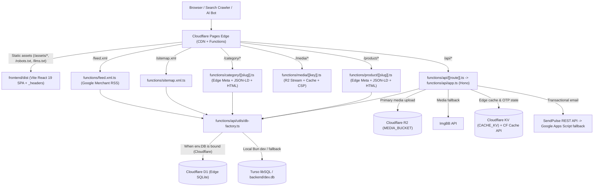

# E-Commerce Edge Architecture & Replication Guide

This document describes the complete code architecture, security model, database/storage pipelines, SEO/GEO engine, and Cloudflare Pages hosting setup of this repository—along with step-by-step instructions to build and deploy a new e-commerce site using the exact same blueprint.

---

## 1. High-Level Architecture & Request Flow

This repository is a **single-repo, full-stack edge application** hosted on **Cloudflare Pages** (static React SPA + Cloudflare Pages Functions). The exact same Hono API runs both on **Cloudflare Workers/Pages** in production and on **Bun** during local development.



---

## 2. Tech Stack & Repository Layout

### Core Stack (`package.json`)
* **Runtime / Package Manager**: Bun (for local server, scripts, and builds) + Cloudflare Workers (`nodejs_compat` flag).
* **Frontend**: React `^19.2.5`, TypeScript `~6.0.2`, Vite `^8.0.10`, Tailwind CSS `^4.2.4` (`@tailwindcss/vite`), React Router `^7.14.2`, Zustand `^5.0.12`, Axios `^1.16.0`, Lucide React, `react-hot-toast`, `react-helmet-async`.
* **Edge API**: Hono `^4.12.16` (`hono/cloudflare-pages`, `hono/cors`, `hono/csrf`, `hono/jwt`, `hono/secure-headers`).
* **Database & ORM**: Drizzle ORM `^0.45.2` + Drizzle Kit `^0.31.10` (`drizzle-orm/d1` in Cloudflare, `drizzle-orm/libsql` + `@libsql/client` locally).
* **Cloudflare Bindings (`wrangler.toml`)**:
  * `DB`: Cloudflare D1 (distributed SQLite)
  * `MEDIA_BUCKET`: Cloudflare R2 (zero-egress object storage)
  * `CACHE_KV`: Cloudflare KV (edge cache & transient auth/OTP storage)

### Directory Structure

```text
.
├── wrangler.toml                  # Cloudflare Pages build dir + Prod & Preview D1/R2/KV bindings
├── package.json                   # Root scripts (dev, build, deploy, db:*, d1:*, r2:*, crawl)
├── server.ts                      # Local Bun entrypoint running functions/api/app.ts + midnight cache timer
├── tsconfig.json                  # Project references -> frontend/tsconfig.app.json & tsconfig.node.json
├── .env.example / .dev.vars.example
├── .github/workflows/
│   └── daily-auto-crawl.yml       # Daily 03:00 UTC GitHub Action running scripts/daily_auto_crawl.ts
├── frontend/                      # React SPA
│   ├── index.html                 # Static SEO/GEO head tags & Organization/WebSite/FAQ JSON-LD
│   ├── vite.config.ts             # Proxy (/api -> :9998) + manualChunks vendor splitting
│   ├── public/
│   │   ├── _headers               # Cloudflare Pages CSP, HSTS, X-Frame-Options & asset Cache-Control
│   │   ├── robots.txt             # Search & AI crawler directives
│   │   ├── llms.txt / llms-full.txt
│   │   └── *-indexnow-key-*.txt   # IndexNow verification file
│   └── src/
│       ├── App.tsx                # Lazy routes, FeatureRoute tier guards, ProtectedRoute, layout switch
│       ├── config/                # store.config.ts, env_proxy.ts, tierCapabilities.ts
│       ├── services/              # api.ts (Axios + interceptors) & apiCache.ts (dedup + TTL cache)
│       ├── store/                 # Zustand stores (auth, cart, home, settings, ui, user, sysadm, recentlyViewed)
│       ├── pages/                 # Storefront, account/*, admin/*, sysadm/*
│       └── components/            # UI, layout, home, product, admin
├── functions/                     # Cloudflare Pages Functions (compiled & deployed automatically by Wrangler)
│   ├── product/[[slug]].ts        # Edge SEO injection + fallback HTML + real 404 for /product/*
│   ├── category/[[slug]].ts       # Edge SEO injection + fallback HTML + real 404 for /category/*
│   ├── media/[[key]].ts           # R2 media streaming at /media/*
│   ├── sitemap.xml.ts             # Dynamic XML sitemap (products + categories + image tags)
│   ├── feed.xml.ts                # Dynamic Google Merchant Center RSS feed
│   └── api/
│       ├── [[route]].ts           # Catch-all exporting onRequest from ./app
│       ├── app.ts                 # Canonical Hono API app (middleware, security, v1 routers, /sitemap.xml, /media/*)
│       ├── types.ts               # Cloudflare Bindings & Hono Variables typings
│       ├── config/cloudflare-env.ts
│       ├── routers/               # Modular Hono route handlers (22+ domain routers + sysadm/provision/storeFactory)
│       └── utils/                 # db-factory, cache, auth-helper, sysadmAuth, rateLimiter, email, helpers, backup/*
├── backend/
│   ├── drizzle.config.ts          # Drizzle Kit config (schema -> ./server/db/schemas/index.ts, out -> ./drizzle)
│   ├── drizzle/                   # Generated SQL migrations (0000_*.sql ..)
│   └── server/
│       ├── config/cloudflare-env.ts # Centralized prod/preview Cloudflare IDs & names synced with wrangler.toml
│       ├── db/schema.ts           # Re-exports ./schemas
│       ├── db/schemas/            # Modular Drizzle SQLite table definitions
│       └── index.ts               # Legacy/partial standalone Hono subset (use functions/api/app.ts instead)
└── scripts/                       # d1-migrate.ts, daily_auto_crawl.ts, seeding, sync, and security test scripts
```

---

## 3. Frontend Architecture (`frontend/`)

1. **Centralized Store Identity (`frontend/src/config/store.config.ts`)**:
   * Defines `STORE_CONFIG` (store name, legal entity, domain, `siteUrl`, currency, support info, socials, address, SEO templates).
   * Runtime overrides are stored in the `system_settings` DB table and loaded dynamically.
2. **Code Splitting & Bundle Optimization (`frontend/vite.config.ts` & `App.tsx`)**:
   * Every route component in `App.tsx` uses `React.lazy(...)` with `<Suspense>` skeletons (`PageSkeleton`, `AdminPageSkeleton`).
   * `vite.config.ts` splits third-party dependencies via `manualChunks` (`vendor-react`, `vendor-router`, `vendor-zustand`, `vendor-lucide`, `vendor-toast`, `vendor-http`, `vendor-motion`, `vendor-charts`, `vendor-ui-primitives`, `vendor-misc`).
3. **Three Layout Surfaces in `App.tsx`**:
   * **Storefront**: `Popup`, `Navbar`, `CategorySidebarDrawer`, `Footer`, `FloatingWhatsApp`, `MobileBottomNav`.
   * **Customer Account (`/account/*`)**: Guarded by `<ProtectedRoute role="user" />` and `<FeatureRoute feature="..." />`.
   * **Admin (`/admin/*`) & SuperAdmin (`/sysadm/*`)**: Layoutless (`data-layoutless="true"`), hiding storefront chrome.
4. **Feature Flags / Tier System (`frontend/src/config/tierCapabilities.ts`)**:
   * Supports modular feature gating (`feature.dashboard`, `feature.wallet`, `feature.loyalty`, `feature.returns`, `feature.showrooms`, etc.) toggled via `system_settings`.
5. **Client API & Caching Layer (`frontend/src/services/api.ts` & `apiCache.ts`)**:
   * `ENV.API_BASE_URL` uses `(import.meta.env.VITE_API_URL || "") + "/api/v1"`. Leaving `VITE_API_URL=""` in production makes all API calls **same-origin** (no CORS preflight).
   * On startup, `App.tsx` calls `fetchHomeData()` (`/api/v1/bulk/home`), which loads banners, categories, products, and settings in one round-trip.
   * Axios request interceptor attaches customer JWT (`auth-storage` in `localStorage`) or admin API key/token on admin routes.
   * Axios response interceptor invalidates matching GET caches and dispatches `settings-updated` / `admin-stats-updated` browser events whenever a `POST`/`PUT`/`PATCH`/`DELETE` succeeds.

---

## 4. Edge Backend & Pages Functions (`functions/`)

### A. Consolidated Hono API (`functions/api/app.ts`)
Cloudflare Pages routes `/api/*` through `functions/api/[[route]].ts` into `app.ts`. In local dev, `server.ts` executes the exact same `app.fetch`.

**Middleware Order in `app.ts`**:
1. **Env Bridge**: Merges `process.env` into `c.env` so Bun/Node and Cloudflare Workers behave identically.
2. **Security Headers (`secureHeaders`)**: `X-Frame-Options: SAMEORIGIN`, `frame-ancestors 'self'`, `nosniff`, HSTS, `strict-origin-when-cross-origin`, `CORP: cross-origin`, `COOP: same-origin`.
3. **CORS (`isAllowedStorefrontOrigin`)**: Allows `env.SITE_URL`, `env.ALLOWED_ORIGINS`, `*.pages.dev`, and `localhost` / `127.0.0.1`.
4. **CSRF + Mutation Origin Guard**:
   * Applies Hono `csrf()` middleware.
   * Rejects `sec-fetch-site: cross-site` or untrusted `Origin` / `Referer` on `POST`/`PUT`/`PATCH`/`DELETE`.
   * Rejects `application/x-www-form-urlencoded` and `text/plain` on JSON mutation endpoints (`415 UnsupportedMediaType`) to block simple-request CSRF bypasses (except `/upload-image`).
5. **Fast-Path Health Check**: `/api/health` and `/api/v1/health` run *before* `logger()` and DB setup to avoid log spam and DB overhead.
6. **DB Injection Middleware**: Calls `createDb(c.env)` and sets `c.set("db", db)`.
7. **Sanitized Error Handler (`app.onError`)**: Logs full errors only in `development` and returns sanitized JSON via `formatSanitizedError`.
8. **`/api/v1` Sub-App Guards**:
   * **Rate Limiting (`rateLimiter.ts`)**: `globalApiRateLimiter` + stricter limiters on auth (`authRateLimiter`), checkout (`checkoutRateLimiter`), and polling (`pollingRateLimiter`). Includes bounded in-memory maps (`MAX_RATE_LIMIT_ENTRIES = 10_000`) and escalating IP jailing (`jailIp`).
   * **Auth Context (`auth-helper.ts`)**: Timing-safe SHA-256 `constantTimeEqual` check for `ADMIN_API_KEY` / `SYSADM_SECRET`, plus `HS256` JWT verification with `JWT_SECRET` (`exp` enforced).
   * **Demo Mode Lock**: If `demo.mode` (DB) or `DEMO_MODE=true` (env) is active, or the token belongs to a demo account, all non-auth/non-sysadm mutating requests return `403 Forbidden`.
   * **Route Authorization**: Strict admin-only path check -> verified admin bypass -> explicit public `GET` allowlist -> authenticated customer prefixes (`/addresses`, `/wallet`, `/notifications`, `/returns`, `/users/`, `/bulk/user`) -> public mutation allowlist.
9. **SuperAdmin (`/api/v1/sysadm`)**: Mounted directly on `app` (bypassing `v1` middleware), using OTP + ephemeral/secret-signed JWT (`sysadmAuth.ts`) and housing:
   * `provision.ts`: Calls Cloudflare REST API v4 to create D1, R2, and KV resources and patch `wrangler.toml`.
   * `storeFactory.ts`: 1-click multi-niche catalog & settings presets.

### B. Edge SEO & Zero-JS Crawler Injection (`functions/product/[[slug]].ts` & `functions/category/[[slug]].ts`)
Because SPAs normally serve an empty `<div id="root"></div>` and `200 OK` even for invalid slugs, these two Pages Functions intercept `/product/*` and `/category/*`:
1. Query D1/Turso directly for the product or category by `slug` or `id` (with `systemSettings` for store name/currency).
2. Fetch the static `index.html` via `context.next()`.
3. **If not found**: Strip default tags, inject `noindex, nofollow` + 404 HTML fallback, and return a **real HTTP `404`** (eliminating Soft 404s).
4. **If found**: Escape & sanitize all fields, inject dynamic `<title>`, `<meta name="description">`, canonical URL, `hreflang`, OpenGraph (`og:*`, `product:price:*`), Twitter cards, JSON-LD (`Product` + `BreadcrumbList` or `CollectionPage` + `BreadcrumbList`), and semantic server-rendered HTML inside `<div id="root">...</div>` so crawlers without JS see full product/category markup immediately.

### C. R2 Media Proxy (`functions/media/[[key]].ts` & `/media/:key` in `app.ts`)
* Validates method (`GET`/`HEAD` only) and runs multi-pass URL decode checks to block path traversal (`..`, `\`, `//`, null bytes, control chars).
* Reads from `env.MEDIA_BUCKET.get(cleanKey)`.
* Infers MIME type, sets `Cache-Control: public, max-age=31536000, immutable`, supports `ETag` / `304 Not Modified`.
* Sandboxes SVGs (`Content-Security-Policy: default-src 'none'; sandbox; style-src 'unsafe-inline'`) and forces HTML files to download as attachments to prevent stored XSS.

---

## 5. Database, Caching, Media & Email Pipelines

### A. Dual-Provider Database (`functions/api/utils/db-factory.ts`)
* **Priority 1 — Cloudflare D1**: Used automatically whenever `env.DB` is bound (Cloudflare Pages/Workers). Memoizes the Drizzle D1 instance per binding object.
* **Priority 2 — Turso / Local SQLite**: Used when `env.DB` is absent (Bun local dev). Connects via `@libsql/client` to `env.TURSO_URL` (with `TURSO_AUTH_TOKEN`), defaulting to `file:backend/dev.db`, with a bounded client pool (max 20) and graceful shutdown hooks.

### B. Schema & Migrations (`backend/server/db/schemas/` & `backend/drizzle/`)
All tables live in modular files under `backend/server/db/schemas/` and are barrel-exported by `backend/server/db/schemas/index.ts` (and `backend/server/db/schema.ts`):
* **Catalog**: `products`, `categories`, `productCategories`, `banners`, `productPriceHistory`, `productSales`.
* **Commerce & Users**: `users`, `addresses`, `userCarts`, `orders`, `orderItems`, `trackings`, `returns`, `reviews`, `coupons`, `walletTransactions`, `otpCodes`.
* **Loyalty & Engagement**: `loyaltyTiers`, `loyaltyRewards`, `loyaltyTransactions`, `loyaltyRedemptions`, `userLoyalty`, `userInteractions`, `productSimilarity`, `notifications`, `newsletterLeads`, `popupSettings`.
* **System**: `systemSettings`, `systemCache`, `adminLogs`.

### C. Multi-Layer Caching
1. **Frontend In-Memory Cache (`frontend/src/services/apiCache.ts`)**: TTL cache + in-flight request deduplication.
2. **Router Micro-Cache (`functions/api/routers/bulk.ts`)**: 15s in-memory micro-cache + in-flight coalescing for `/bulk/user`, `/bulk/admin-stats`, and `/bulk/home`.
3. **Edge Cache (`functions/api/utils/cache.ts` + `CACHE_KV`)**: Uses Cloudflare `caches.default` / `caches.open('aurelia-super-cache')` + `CACHE_KV` (`home_bulk` cached for 1 hour), falling back to an in-memory `Map` in Bun dev. Invalidated automatically on catalog/settings mutations via `invalidateHomeCache()`.

### D. Image Upload Pipeline (`functions/api/routers/system.ts`)
* Endpoint: `POST /api/v1/system/upload-image` (multipart or JSON).
* If `env.MEDIA_BUCKET` (R2) is bound: writes object to R2 and returns `/media/<key>`.
* If R2 is not bound: falls back to **ImgBB** (`env.IMGBB_API_KEY`).

### E. Email Pipeline (`functions/api/utils/email.ts`)
* **Primary**: **SendPulse** OAuth2 + `/smtp/emails` REST API (`SENDPULSE_CLIENT_ID`, `SENDPULSE_CLIENT_SECRET`, `SENDPULSE_FROM_EMAIL`, `SENDPULSE_FROM_NAME`), with OAuth token caching.
* **Fallback**: **Google Apps Script** webhook (`GOOGLE_SCRIPT_URL`, authenticated with `EMAIL_WEBHOOK_SECRET`).
* **Dev Fallback**: Logs email details cleanly when neither provider is configured locally.

---

## 6. SEO, GEO & Automated Indexing

* **Static Head & Knowledge Graph (`frontend/index.html`)**: Pre-configured OpenGraph, Twitter Cards, verification meta tags, and `@graph` JSON-LD (`Organization`, `WebSite` with `SearchAction`, `SoftwareApplication`, `OnlineStore`, `FAQPage`).
* **AI/GEO Discovery (`frontend/public/`)**: `robots.txt` (explicitly allows `GPTBot`, `OAI-SearchBot`, `PerplexityBot`, `ClaudeBot`, `Google-Extended`, `Applebot-Extended` while blocking `/admin/` and `/api/`), `llms.txt`, and `llms-full.txt`.
* **Live Feeds**: `/sitemap.xml` (includes `<image:image>`) and `/feed.xml` (Google Merchant Center `xmlns:g` RSS).
* **IndexNow**: Key verification served dynamically by `app.ts` (`/:key.txt`) or static file in `frontend/public/`, plus `POST /api/v1/seo/ping`.
* **Daily Auto-Crawl (`.github/workflows/daily-auto-crawl.yml`)**: Runs `bun run scripts/daily_auto_crawl.ts` every day at `03:00 UTC`, parses `sitemap.xml`, warms Cloudflare Edge Cache across all URLs (concurrency 8), and submits URLs to IndexNow + Google/Bing ping endpoints.

---

## 7. Step-by-Step Instructions: Replicating & Hosting a New Store

### Phase 1: Create Cloudflare Resources

Install/authenticate Wrangler (`bunx wrangler login`) and create separate **production** and **preview** resources:

```bash
# 1. Create D1 databases (Production + Preview)
bunx wrangler d1 create my-new-store
bunx wrangler d1 create my-new-store-prev

# 2. Create R2 buckets (Production + Preview)
bunx wrangler r2 bucket create my-new-store
bunx wrangler r2 bucket create my-new-store-prev

# 3. Create KV namespaces (Production + Preview)
bunx wrangler kv namespace create CACHE_KV
bunx wrangler kv namespace create CACHE_KV --preview

# 4. Create the Cloudflare Pages project
bunx wrangler pages project create my-new-store --production-branch main
```

Record the returned `database_id` UUIDs and KV `id` strings.

---

### Phase 2: Update Project Configuration & Domain References

Update every hardcoded project/domain reference before deploying:

1. **`wrangler.toml`**:
   * Set `name = "my-new-store"` and keep `pages_build_output_dir = "frontend/dist"`, `compatibility_date = "2024-09-23"`, `compatibility_flags = ["nodejs_compat"]`.
   * Replace `[[kv_namespaces]]`, `[[d1_databases]]`, `[[r2_buckets]]` under root, `[env.production]`, and `[env.preview]` with your new IDs and names.
2. **`backend/server/config/cloudflare-env.ts`**:
   * Update `WRANGLER_ENV_KEYS` (`projectName`, `production`, `preview`) to match `wrangler.toml` so migration/provisioning scripts target the right resources.
3. **`frontend/src/config/store.config.ts`**:
   * Update `STORE_CONFIG` (brand name, domain, `siteUrl`, currency, support email, social handles, address, SEO defaults, verification codes).
4. **`frontend/public/_headers`**:
   * Update the `Content-Security-Policy` `img-src` and `connect-src` directives to replace `ecom.orbitsaas.cloud` / `aureliabd.shop` with your new domain(s).
5. **`functions/api/app.ts`**:
   * Update `isAllowedStorefrontOrigin()` (around lines 86–90) to allow your production domain (in addition to `env.SITE_URL`, `env.ALLOWED_ORIGINS`, and `*.pages.dev`).
   * Update the IndexNow key in `seoRouter` (`POST /api/v1/seo/ping`) and `/:key.txt` route, and place the matching `<your-indexnow-key>.txt` in `frontend/public/`.
6. **SEO & GEO Files**:
   * Update canonical URLs, verification meta tags, and Schema.org `@graph` entities in `frontend/index.html`.
   * Update `frontend/public/robots.txt`, `frontend/public/llms.txt`, `frontend/public/llms-full.txt`.
   * Update `CONFIG` (`host`, `baseUrl`, `sitemapUrl`, `indexNowKey`, `indexNowKeyLocation`) in `scripts/daily_auto_crawl.ts`.
   * Update `SYSADM_EMAIL` in `functions/api/utils/sysadmAuth.ts` if you use `/sysadm` OTP login.

---

### Phase 3: Configure Environment Variables & Secrets

1. **Local Bun Dev (`.env`) & Wrangler Local Dev (`.dev.vars`)**:
   Copy `.env.example` to `.env` and `.dev.vars.example` to `.dev.vars`:
   ```env
   PORT=9998
   VITE_API_URL=http://127.0.0.1:9998

   # Local SQLite or Turso libSQL fallback
   TURSO_URL=file:backend/dev.db
   TURSO_AUTH_TOKEN=

   # Security & Auth (use strong 32+ byte random strings)
   JWT_SECRET=replace_with_64_hex_chars
   ADMIN_API_KEY=replace_with_64_hex_chars
   ADMIN_USERNAME=admin
   ADMIN_PASSWORD=replace_with_strong_password
   SYSADM_SECRET=replace_with_64_hex_chars

   # Origin & Runtime
   NODE_ENV=development
   DEMO_MODE=false
   SITE_URL=http://localhost:9999
   ALLOWED_ORIGINS=http://localhost:9999,http://localhost:9998

   # Email (SendPulse primary / Google Apps Script fallback)
   SENDPULSE_CLIENT_ID=...
   SENDPULSE_CLIENT_SECRET=...
   SENDPULSE_FROM_EMAIL=support@yourdomain.com
   SENDPULSE_FROM_NAME=YourStore
   ```

2. **Cloudflare Pages Production & Preview Secrets**:
   Set all runtime secrets in Cloudflare Pages (Dashboard -> Settings -> Environment Variables, or via CLI):
   ```bash
   bunx wrangler pages secret put JWT_SECRET --project-name my-new-store
   bunx wrangler pages secret put ADMIN_API_KEY --project-name my-new-store
   bunx wrangler pages secret put ADMIN_USERNAME --project-name my-new-store
   bunx wrangler pages secret put ADMIN_PASSWORD --project-name my-new-store
   bunx wrangler pages secret put SYSADM_SECRET --project-name my-new-store
   bunx wrangler pages secret put SENDPULSE_CLIENT_ID --project-name my-new-store
   bunx wrangler pages secret put SENDPULSE_CLIENT_SECRET --project-name my-new-store
   ```
   Also set plain env vars in Cloudflare Pages for **Production** (and **Preview** as needed):
   * `NODE_ENV=production`
   * `DEMO_MODE=false` (set `"true"` only if running a read-only demo)
   * `SITE_URL=https://yourdomain.com`
   * `ALLOWED_ORIGINS=https://yourdomain.com,https://www.yourdomain.com`
   * `SENDPULSE_FROM_EMAIL` / `SENDPULSE_FROM_NAME`
   * **Important**: Do **not** set `VITE_API_URL` in production (or set it to `""`) so the Vite bundle uses same-origin `/api/v1`. Never prefix backend secrets with `VITE_`.

---

### Phase 4: Database Migrations & Initial Seeding

1. **Generate SQL migrations from Drizzle schema** (whenever `backend/server/db/schemas/*.ts` changes):
   ```bash
   bun run db:generate
   ```
2. **Apply migrations locally & remotely**:
   ```bash
   # Local SQLite / Turso (Drizzle Kit)
   bun run db:migrate

   # Local Wrangler D1 emulation
   bun run d1:migrate:local

   # Remote Cloudflare D1 (Production & Preview)
   bun run d1:migrate:remote
   bun run d1:migrate:preview
   ```
3. **Seed initial store settings / catalog**:
   Adapt `scripts/seed_products_and_subcategories.ts` or `backend/server/db/schemas` seed data for your new niche, or use the Admin/SuperAdmin panel once deployed.

---

### Phase 5: Local Development Workflows

Choose whichever mode fits what you are testing:

* **Fast Hot-Reload Dev (Bun + Vite)** — best for daily UI & API work:
  ```bash
  bun run dev
  ```
  Runs `server.ts` on `http://127.0.0.1:9998` and Vite on `http://localhost:9999` (with `/api` proxied to `9998`). Uses `TURSO_URL` or `file:backend/dev.db` and in-memory cache fallbacks.
* **Full Cloudflare Edge Emulation (`wrangler pages dev`)** — best for testing D1, R2, KV, `/product/*`, `/category/*`, `/media/*`, and `/sitemap.xml`:
  ```bash
  bun run build
  bun run preview
  # Or for preview bindings: bun run preview:cf
  ```

---

### Phase 6: Build, Deploy & Post-Deploy Checklist

1. **Typecheck, Lint, Build, and Deploy**:
   ```bash
   bun run lint
   bun run deploy
   ```
   *(If connecting GitHub directly to Cloudflare Pages for automatic CI/CD builds, set the build command to `bun run build` and build output directory to `frontend/dist`, and ensure D1/R2/KV bindings are configured for both Production and Preview in the Cloudflare dashboard or via `wrangler.toml`.)*
2. **Attach Custom Domain**:
   * In Cloudflare Pages -> **Custom domains**, add `yourdomain.com` (and `www` redirect if desired).
3. **Verify Production Endpoints**:
   * `GET https://yourdomain.com/api/v1/health` -> `{"status":"ok",...}`
   * `GET https://yourdomain.com/sitemap.xml` -> valid XML listing active products/categories
   * `GET https://yourdomain.com/product/<valid-slug>` -> `200 OK` with product `<title>`, `og:image`, and `application/ld+json` in raw HTML source
   * `GET https://yourdomain.com/product/non-existent-slug-test` -> HTTP `404` (not `200`)
   * Upload a test image in `/admin` -> verify it writes to R2 and loads from `/media/<key>`
   * Place a test order / trigger forgot-password -> verify SendPulse email delivery and `POST` mutation Origin/CSRF headers work on your custom domain
4. **Enable Daily Auto-Crawl**:
   * Confirm `.github/workflows/daily-auto-crawl.yml` is enabled in GitHub Actions so your sitemap is crawled, edge cache is warmed, and IndexNow is pinged daily.

---

### Common Pitfalls to Avoid
* **Soft 403s on Mutations in Production**: Every `POST`/`PUT`/`PATCH`/`DELETE` goes through `isAllowedStorefrontOrigin` in `functions/api/app.ts`. If your custom domain is missing from `SITE_URL`, `ALLOWED_ORIGINS`, or `isAllowedStorefrontOrigin`, API writes will be blocked with `403`.
* **CSP Blocking Images or Fonts**: `frontend/public/_headers` enforces a strict `Content-Security-Policy`. If you add external image CDNs, analytics, or subdomains, add them to `img-src` / `connect-src` in `_headers`.
* **`VITE_API_URL` Baked into Production**: Never leave `VITE_API_URL=http://127.0.0.1:9998` in your Cloudflare Pages build environment—otherwise production visitors will try to call `localhost`.
* **Production `JWT_SECRET` Length**: `functions/api/routers/auth.ts` throws an error in `NODE_ENV=production` if `JWT_SECRET` is missing or shorter than 32 characters.
* **Demo Mode Left Enabled**: Check both the `DEMO_MODE` env var and the `demo.mode` row in `system_settings`—if either is `"true"`, all customer checkout and admin mutations are blocked with `403`.
